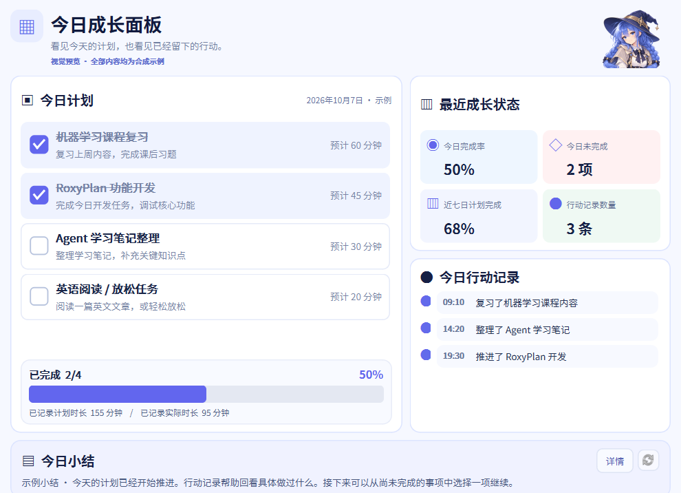
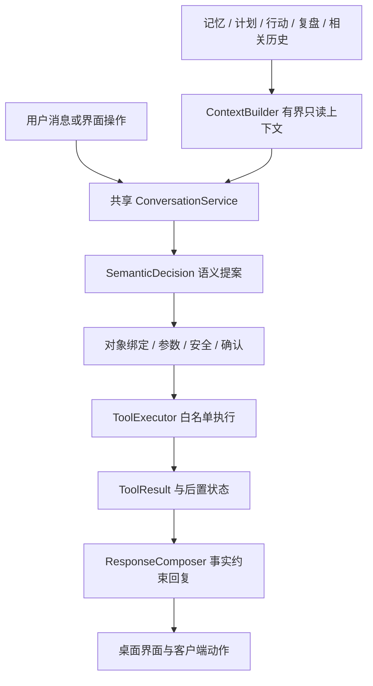

# RoxyPlan · 洛琪希计划

### 让成长，不必那么用力。

**[下载 Windows 安装版](https://github.com/pluto525748/-RoxyPlan/releases/download/v0.9.0-aic2026-rc.1/RoxyPlan-0.9.0-aic2026-rc.1-Setup-x64.exe)** · [免安装 ZIP](https://github.com/pluto525748/-RoxyPlan/releases/download/v0.9.0-aic2026-rc.1/RoxyPlan-0.9.0-aic2026-rc.1-Windows-x64.zip) · [查看全部下载与演示](https://github.com/pluto525748/-RoxyPlan/releases/tag/v0.9.0-aic2026-rc.1)

Windows 10/11 x64；无需 Python 或 Conda。聊天需配置自己的 DeepSeek Key，或本地 Ollama。当前为未签名的体验候选版。

Windows 本地运行的成长陪伴 AI 桌宠：自然聊天、安排学习、记录真正完成的小事，在复盘后接着下一天继续。**计划**是预先安排的目标，**行动**也可以是计划之外真实完成的小事。

AIC 2026 完整自研源码候选，来源提交 `71bbaea`，包含后续修复，不追认比赛实际提交的软件与本版本一致。产品仍是 **V0.9 原型**；历史“V2.2”表示交互稳定化阶段。

[演示视频](https://github.com/pluto525748/-RoxyPlan/releases/download/v0.9.0-aic2026-rc.1/RoxyPlan-AIC2026-demo.mp4) · [验证结果](docs/verification/README.md) · [能力边界](docs/capability_boundaries.md) · [MIT代码许可](LICENSE) · [素材范围](ASSET_LICENSE.md)

## 三大亮点

**低压力的成长陪伴。** 今日成长面板把计划、实际行动、已记录时长和复盘放在一起。不要求先建计划才认可进步，也不把“没记录”说成“什么都没做”。

**有执行依据的Agent。** 模型负责理解和建议，程序负责参数、对象、权限、确认及执行。没有匹配的工具成功结果，不能声称已添加、完成或删除。

**能接续的学习上下文。** 当前实例的目标、近期计划、行动、复盘和相关学习讨论进入有界上下文。明确学习请求使用完整学习投影；每日会话的省略表达也保留成长参考，不需要每次重述昨天的记录。

## 桌面界面

以下是当前源码组件的离线渲染，全部为**合成示例**，没有模型调用，不是真人体验或效果证明。图中角色遵循独立素材许可。




[记忆管理界面](docs/images/memory.png)：查看原文、分类筛选、编辑、归档、冲突和删除确认。候选记忆不是普通用户入口。

## Agent架构



- `modules/`：共享Agent、工具校验、Memory、Growth、上下文和Repository。
- `frontend/`：PySide6桌宠、聊天、设置、记忆及成长界面；包含拖动跑步、静止思考气泡、睡眠及动作派发。
- `server/`：可选Local Web适配，复用相同业务，不是第二套Agent或默认公网服务。
- `tests/`、`scripts/`：隔离测试、回放夹具、语料、模型验收和预算工具。

模型不能直接修改JSON，也没有任意Shell或电脑控制权限。具体实现见 [代码地图](docs/learning/roxyplan_file_map_simple.md)。

## 学习闭环

```text
目标与偏好 → 今日建议（未写入） → 用户选择 → 保存计划
                  ↓                         ↓
              具体知识讲解              完成状态 / 计划外行动
                                            ↓
                                        保存当日复盘
                                            ↓
                         次日读取真实历史 → 调整下一步建议
```

完成计划不伪造行动和实际时长；尊重用户对完成与掌握的判断，不额外增加掌握测验。旧复盘是历史记录，不能覆盖当前执行状态。

可尝试：`记住：我偏好先看例子再讲概念。` → `给我两项今天的学习建议，先不要加入。` → `把第一项加入今天计划。` → `记录今天的计划外行动：整理笔记，实际用了8分钟。` → `今日复盘。`

自然表达仍可能误判或澄清，具体序号、确认、取消和日期边界以 [能力契约](docs/capability_boundaries.md) 为准，不保证任意中文均成功。

## 演示视频

[播放／下载 AIC 演示视频（MP4，约4分53秒）](https://github.com/pluto525748/-RoxyPlan/releases/download/v0.9.0-aic2026-rc.1/RoxyPlan-AIC2026-demo.mp4)

由负责人提供并授权公开。视频是演示材料，不是多人真实连续学习实验；推进业务日期不代表现实经过天数。文件版本及处理信息见 [演示说明](docs/demo.md)。

## 安装运行

### 普通用户：下载安装版

1. 点击顶部 **下载 Windows 安装版**，运行 `Setup-x64.exe`，按提示安装。
2. 打开桌面快捷方式 **RoxyPlan**，右键桌宠选择“打开聊天”。
3. 打开设置，配置自己的模型服务，之后即可聊天、安排计划、记录行动和复盘。

安装版与 ZIP 日常版使用真实日期，记录保存在 `%LOCALAPPDATA%\RoxyPlan`；程序与记录分开，卸载保留记录。更新前退出旧程序。ZIP 需完整解压到新文件夹，不能单独复制 EXE。

需要试验跨天衔接时，单独下载 [跨天体验版 ZIP](https://github.com/pluto525748/-RoxyPlan/releases/download/v0.9.0-aic2026-rc.1/RoxyPlan-0.9.0-aic2026-rc.1-study-Windows-x64.zip)。它使用隔离数据目录和手动推进业务日期，与日常版记录分开，不代表真人连续使用天数。

运行前需有适用的 [Microsoft Visual C++ x64运行库](https://learn.microsoft.com/en-us/cpp/windows/latest-supported-vc-redist)。安装包未签名，Windows 可能提示发布者未知；请从本项目 Release 下载并核对 `SHA256SUMS.txt`，无需关闭安全防护。当前包的检查范围见 [Windows 发行核验](docs/verification/windows-release.json)，尚无另一台无 Python 电脑的完整界面验收。

### 开发者：从源码运行

Windows 10/11 x64，Python 3.10。

```powershell
git clone --branch codex/aic2026-release https://github.com/pluto525748/-RoxyPlan.git RoxyPlan
cd RoxyPlan
py -3.10 -m venv .venv
.\.venv\Scripts\python.exe -m pip install -r requirements.txt
.\roxy.bat
```

从桌宠打开聊天，在设置中配置自己的模型服务。在线对话需要网络和自己的DeepSeek凭据，或可用的本地Ollama。仓库没有Key、模型权重或免费的托管服务。详见 [模型配置](docs/model_routing.md)。

### 无密钥离线预览

```powershell
.\.venv\Scripts\python.exe -B scripts\preview_chat.py
.\.venv\Scripts\python.exe -B scripts\preview_growth.py --scenario populated
```

预览使用独立合成数据，仅观察界面，不是在线业务验收。

### 独立实例与跨天演示

```powershell
.\roxy_simulated_days.bat -InstanceRoot "$env:LOCALAPPDATA\RoxyPlanTestInstances\demo"
```

首次从当天开始，后续恢复该实例保存的业务日期；“推进一天”不修改Windows时间。正常Beta仍使用真实日期；`roxy_study_main.py`是单独构建的日期推进体验版。多名使用者应指定不同数据根，**仅移动程序目录不会自动隔离用户**。模拟日期不能当作真实使用天数。

### 数据与反馈

源码日常入口使用项目中被忽略的运行文件；正常冻结Beta默认保存在 `%LOCALAPPDATA%/RoxyPlan`，日期推进实例使用独立目录。数据不自动上传。

设置 → 导出内测反馈 → 选择范围 → 查看清单 → 明确同意 → 生成本地ZIP。聊天和记忆默认不选，凭据排除。历史界面只读；设置可清空当前实例全部历史，**没有单会话删除按钮**。

## 测试与复用

```powershell
.\.venv\Scripts\python.exe -m pip install -r requirements-dev.txt
.\scripts\run_isolated_tests.ps1 -KeepRun -PytestArgs @('tests/test_daily_growth_reference.py','tests/test_learning_context_continuity.py','tests/test_learning_dialogue_history.py','tests/test_runtime_paths.py','tests/test_feedback_export.py','-q')
```

runner隔离临时目录、日志、报告及应用数据；`-KeepRun`保留现场。共享解释器可传 `-PythonExecutable`，受测项目仍为脚本所属工作树。不要让测试读取正式数据。

公开了真实模型失败捕获的离线回放、参数与对象绑定、跨天上下文、凭据排除等测试。历史三组七日观察177轮、两组自然表达107轮，均为**真实DeepSeek＋工程合成用户＋模拟业务日**，存在失败，不是总体通过率或真人成效。新检查与历史批次分列于 [验证记录](docs/verification/README.md)。

可复用共享会话编排、工具事实回复、类型化引用、成长投影、日期隔离和验收工具，不必连同角色形象一起使用。

## 许可与限制

自研代码、测试和技术文档采用 [MIT](LICENSE)。MIT不覆盖第三方角色素材；图集按作者允许的个人非商业范围分享并署名。见 [ASSET_LICENSE](ASSET_LICENSE.md)、[第三方资源](THIRD_PARTY_RESOURCES.md) 和 [NOTICE](NOTICE)。商业复用代码时应替换受限素材或取得相应许可。

当前是原型：没有任意表达成功率、全量知识准确率和真人长期学习收益结论。知识库轻量读取不作为已验证RAG成果。多角色、云端／移动端及个人资料RAG属于 [未来规划](docs/ROADMAP.md)。已知问题与版本变化见 [验证说明](docs/verification/README.md) 和 [更新日志](docs/CHANGELOG.md)。
