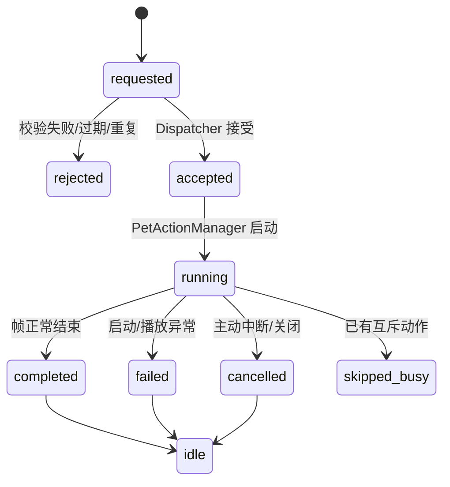

# 桌宠动作状态机（V1.8.2）

## 状态

PetActionManager 的稳定显示状态仍为 `idle`、`thinking`、`sleeping`、`dancing`、`reminding`。ClientActionResult 记录请求生命周期：

## 舞蹈策略

- `idle → dancing`：帧素材至少两张且 QTimer 成功启动。
- `dancing → idle`：完成三循环后 `_stop_dance_frames()` 清理帧、索引、pixmap 和 timer。
- 运行中再次请求：策略 B，返回 `skipped_busy`，不停止当前舞蹈、不排队、不虚假声称第二段已开始。
- 异常：`try/except` 捕获，立即 `restore_idle()`。
- 取消：`cancel_current_action()` 清理播放器并恢复 idle。
- failsafe：舞蹈启动后设置 30 秒单次释放计时器；正常完成时停止该计时器。

## 素材兼容

## 睡眠勿扰

手动、Agent及超时睡眠共用真实睡眠状态；动作被拒绝时不提前宣称入睡。睡眠期间随机提示、学习提醒、主动陪伴、计划完成鼓励及补复盘警告UI保持静默；已经生成后延迟呈现的主动提醒也不能显示或自动唤醒。原失败诊断和计数继续保留。重复睡眠幂等，显式唤醒刷新交互时间，原提醒调度与配置、聊天暂停所有权保持。

### 作者角色图集与等待表现（2026-10-18）

默认角色使用已核对来源的透明图集；帧布局以资源 JSON 与播放器校验为准，不在本文重复维护。用户自选图片和缺失图集时的静态回退保留。左右跑步只在鼠标拖动超过原阈值后借用图集播放，窗口仍由原 mouseMove 链移动；纯上下拖动保留最近左右朝向，不增加自动游走。松手恢复待机，进行中的舞蹈或动作则恢复原帧及剩余计时。

真实回复请求沿原 start_thinking／stop_thinking 生命周期驱动：人物帧与身体动画暂停，独立头顶气泡循环，不使用持续左右晃动。思考期间手动拖动仍移动窗口，但不播放跑步；释放后等待请求结束再恢复原流程。普通文字气泡与思考气泡各自拥有计时器；关闭或退出停止本批播放器及计时器。

图集九类可播放不等于九类业务触发均接入；失败、成功复盘等真实事件接线另行核验，不能从回复关键词猜测执行结果。当前离屏专项通过不代表真实 Windows 外观已验收。

以下内容未修改：

- 路径：`assets/pet/dance/dance_*.png`
- 排序：按 `dance_<数字>` 数字升序
- 单帧时长：`DANCE_FRAME_DURATIONS_MS = (120, 110, 100, 110, 90, 140, 90, 140)`
- 循环次数：3
- 绘制逻辑与素材文件内容

## 诊断

请求日志包含 action_id、name、校验/派发结果、reason_code 和状态前后摘要。完成日志由帧播放器与 Manager 输出；不记录完整用户文本或私密数据。
